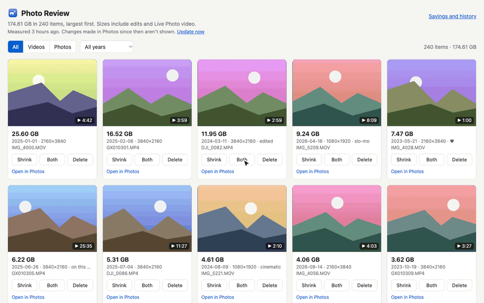
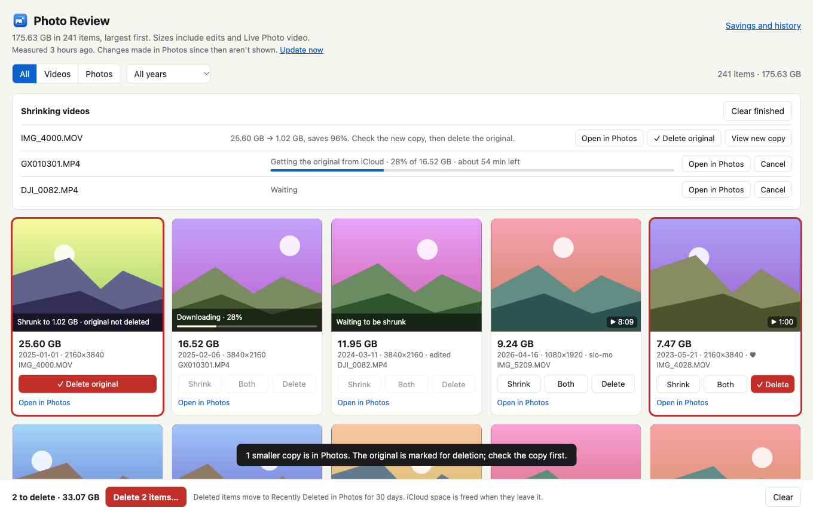
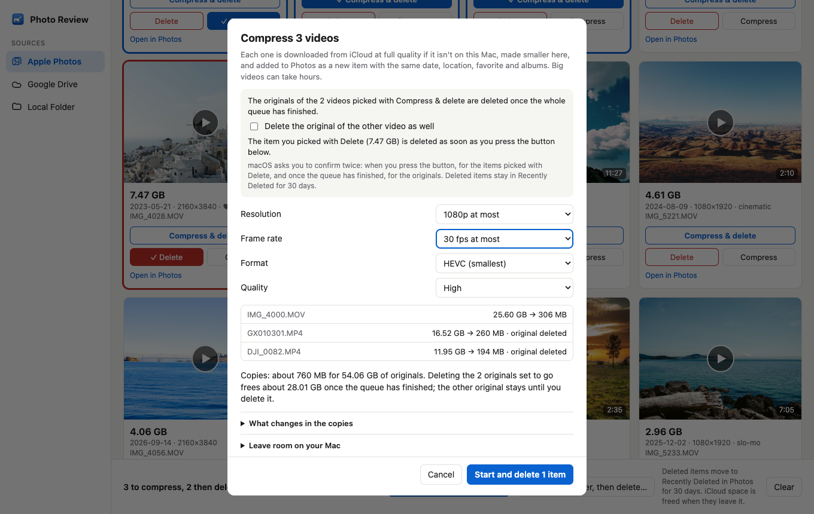
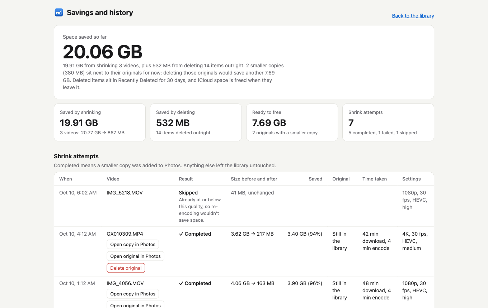

<p align="center"></p>
<h1 align="center">Photo Review</h1>
<p align="center">See what is filling your iCloud Photos storage, then shrink the videos or delete what you don't need.</p>
<p align="center"><a href="https://danielyaa5.github.io/photo-review/"><b>Website and download</b></a></p>



<sub>The demo uses made-up data. In real use macOS asks you to confirm before anything is deleted; that
dialog isn't shown here.</sub>

Photos on the Mac can't sort by file size, so a handful of huge videos can quietly use most of an iCloud plan.
Photo Review lists everything in your library from largest to smallest, lets you preview each item, and gives
you two ways to get space back: delete it, or replace a video with a much smaller copy.

It runs entirely on your Mac. It is a small app that serves a page to your own browser at `127.0.0.1`; nothing
is uploaded anywhere.

## What it does

- **Largest first.** Every photo and video with its real stored size, including edited versions and Live
  Photo video. Filter by type or year.
- **Preview before deciding.** Thumbnails for everything, and in-page playback for videos, including ones
  that are only in iCloud.
- **Three separate picks.** Each video has Shrink, Both and Delete buttons, so you can line up some videos to
  shrink and other things to delete in one pass. Both means shrink it, then delete the original once the
  smaller copy is in Photos. A video in the queue shows its progress on its tile.
- **Shrink videos.** Pick a resolution cap (4K, 1080p, 720p), a frame-rate cap, HEVC or H.264, and a quality
  level. A size estimate updates as you choose. The smaller copy is added to Photos with the original's date,
  location, favorite flag and albums.
- **HDR stays HDR.** iPhone HDR video is re-encoded as 10-bit HEVC with HDR intact. ProRes and other 10-bit
  footage keeps its 10 bits too: it is saved as 10-bit HEVC even if you chose H.264, which would flatten it
  to 8 bits. Slo-mo keeps its timing and sound.
- **Delete with a safety net.** Nothing is removed until you approve the standard macOS confirmation, and
  deleted items go to Recently Deleted for 30 days.
- **Savings page.** A running total of what you have freed, what is still waiting on you, and a log of every
  shrink attempt and deletion.
- **Quick to reopen.** Measuring a large library takes a minute or more, so the result is kept for a day.
  The page says when it was measured, and "Update now" measures again.

| The library, with a queue running | Choosing how far to shrink | Savings and history |
|---|---|---|
|  |  |  |

The screenshots use made-up data.

## How shrinking works

Photos has no way to swap a video's file in place, so a shrink is three steps:

1. The original is downloaded from iCloud at full quality (skipped if it is already on your Mac).
2. It is re-encoded on your Mac with Apple's hardware encoder.
3. The smaller copy is added to Photos as a new item, named like `IMG_1234 (shrunk).mov`.

The original is left alone. When you have checked the new copy, you delete the original yourself. Or pick a
video with Both instead of Shrink, or tick "Delete each original" when starting a batch: once the whole queue
has finished, the app asks Photos to delete the originals of those videos that shrank successfully, and macOS
asks you to confirm once. If a re-encode
would not save a meaningful amount, the video is skipped instead.

As an example, a 43-second 4K HDR iPhone clip went from 482 MB to 27 MB at 1080p, 30 fps, medium quality.
Savings are largest on ProRes and high-bitrate action-camera footage.

## Install

1. [Download PhotoReview.zip](https://github.com/danielyaa5/photo-review/releases/latest/download/PhotoReview.zip)
   (the latest release).
2. Unzip it and move **Photo Review** to your Applications folder.
3. Open it.

The app is signed and notarized by Apple, so it opens like any other downloaded app. It runs on Apple silicon
and Intel Macs with macOS 13 or later, though it has only been tested on macOS 27.

On first launch macOS asks whether Photo Review may access your Photos library; choose **Allow Full Access**,
since it needs to read sizes, add shrunk copies and delete what you select. Your browser then opens at
`http://127.0.0.1:8377`. The first measurement of a large library takes a minute or more, with the biggest
videos shown first; after that the app opens straight away for the rest of the day.

Keep the small Photo Review window open while you work. Closing it quits the app.

### Building it yourself

You need Apple's command line tools (`xcode-select --install`).

```bash
git clone https://github.com/danielyaa5/photo-review.git
cd photo-review
./build.sh
open "Photo Review.app"
```

A local build is signed for your Mac only and uses a different app identity from the release, so macOS asks
for Photos access separately for each.

## Things to know before you rely on it

- **It is new.** It has been built and tested on one Mac (Apple silicon, macOS 27) against one large library.
  Start with a video you don't care about, and keep a backup of anything irreplaceable.
- **Downloads are the slow part.** Photos fetches one original at a time, so a 25 GB video can take over an
  hour before encoding starts. Dropped connections are retried, and Photos has resumed where it left off.
- **Originals stay on disk for a while.** A downloaded original remains on your Mac until Photos clears it,
  so a long queue needs free disk space. The app refuses to start a download it has no room for.
- **Some things don't carry over to a shrunk copy:** edits are baked in rather than kept as edits, and
  captions, keywords, people tags and shared-album membership are lost.
- **Dolby Vision.** The copy keeps the HDR picture. Whether the iPhone's extra Dolby Vision metadata survives
  has not been checked; if it doesn't, the video still plays as HDR.
- **iCloud space is freed later.** Deleted items count against your storage until they leave Recently Deleted.
- **Changes made elsewhere** (new photos, deletions in the Photos app) don't show up until the library is
  measured again: once a day, or when you click "Update now".

## How it is built

One Swift file and two HTML pages, with no dependencies beyond macOS itself.

- `main.swift`: the app. It reads the library through PhotoKit (Apple's supported interface, not the library
  database), serves the pages from a loopback-only HTTP server, re-encodes with AVFoundation and VideoToolbox,
  and keeps its history and the day's measurement in `~/Library/Application Support/Photo Review/`.
- `index.html` and `stats.html`: the library view and the savings page.
- `build.sh`: compiles and signs the app locally.
- `release/`: builds the signed, notarized download (needs a paid Apple Developer team signed in to Xcode).

State-changing requests need a token that only the page served by the app has, and requests arriving under
any other hostname are rejected, so other websites can't drive it.

For development, `--port N` runs a second copy on another port, and `--history FILE` and `--cache FILE` point
it at different data files. A shrink request with `"dryRun": true` encodes to a temporary file and adds nothing to Photos.

## Similar projects

- [PhotoSlim](https://github.com/EvanXuu/photoslim) and [PixelPare](https://github.com/akshaymaloo/pixelpare)
  are native apps that also shrink Photos videos to HEVC. Both skip HDR video by design; PixelPare also finds
  duplicate photos and old screenshots.
- [osxphotos](https://github.com/RhetTbull/osxphotos) is the standard command-line tool for querying and
  exporting a Photos library.
- [Finding big photos](https://alexwlchan.net/2023/finding-big-photos/) describes the size-listing approach
  this app uses.

## License

MIT. See [LICENSE](LICENSE).
