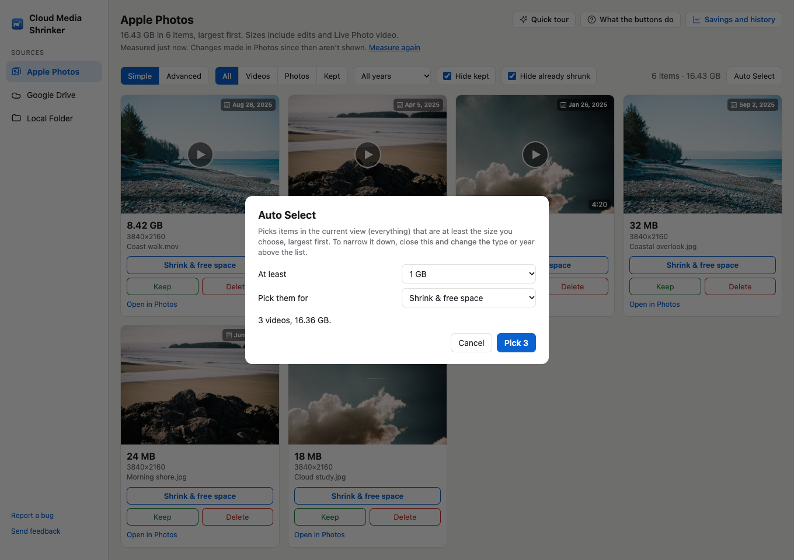
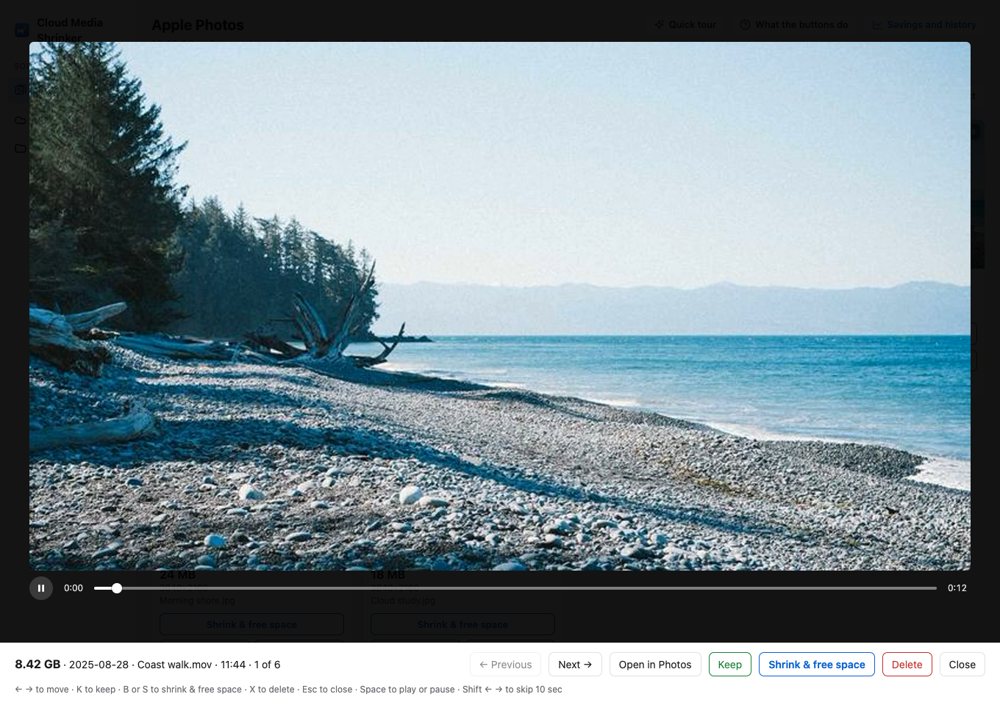
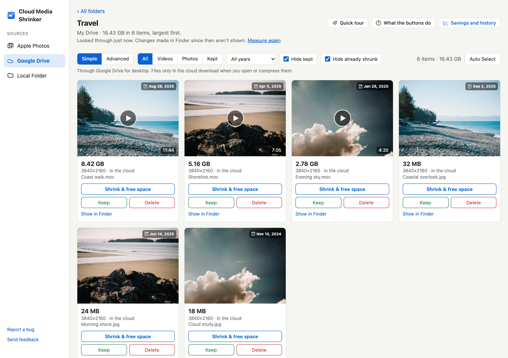

# Cloud Media Shrinker

Sort your photos and videos by size to find what’s taking up the most space. Compress the files you want to keep, or delete the ones you no longer need.

Works with Apple Photos, Google Drive for desktop, and local folders.

**[Download on the Mac App Store](https://apps.apple.com/app/cloud-media-shrinker/id6824383256)**

macOS 13 or later. See the App Store listing for current pricing.

## See it in action

[Watch the demo video](docs/demo.mp4)

Screenshots and demo use fictional sample media and sizes. They show the latest interface, which may differ from the current App Store release.

## Find your biggest files first

Browse Apple Photos from largest to smallest, with file sizes, capture dates, and previews on each tile. Filter by media type or year, and hide items you have kept or already compressed.

## Choose how much to compress

Use Balanced, Maximum Savings, or Preserve 4K presets in Simple mode. Advanced mode gives you control over resolution, frame rate, format, and quality. Compress supported videos, RAW and JPEG photos, or make a still-only copy of a Live Photo.

## Select a batch in one step

Auto Select finds items above a size you choose in the current view. Review the selection before starting. Compression batches account for the room your Mac needs to download originals.

## Preview before deciding

Play videos and seek through the timeline before choosing what to keep. For media stored only in iCloud, the preview can take a few minutes to arrive; the app shows download progress when Photos provides it.

## Apple Photos, Google Drive, and local folders

Review your Photos library, a folder on your Mac or an external drive, or a folder from Google Drive for desktop. Folder compression saves smaller copies in a Compressed folder. You do not sign in to Google inside Cloud Media Shrinker.

## Good to know

- Compression runs on your Mac. The app does not upload your library to the developer.
- Compression is lossy, and savings vary. Check a smaller copy before deleting its original.
- Apple Photos deletions go to Recently Deleted; folder deletions go to the relevant Trash. Cloud storage may not be reclaimed until originals leave Recently Deleted or the service’s trash.
- iCloud originals must download before compression. Leave space on your Mac for them.
- Savings and history keeps a local record of compression and deletion operations.

## Get started

1. Download Cloud Media Shrinker from the Mac App Store.
2. Try the quick tour with sample files.
3. Choose Apple Photos, Google Drive, or Local Folder and grant the requested access.
4. Review your largest items and choose what to compress, keep, or delete.

## Support

[Report a bug or request a feature](https://github.com/danielyaa5/photo-review/issues).

[Privacy policy](https://danielyaa5.github.io/photo-review/privacy.html)

This repository contains product information and demo media. The application source code is maintained privately.
